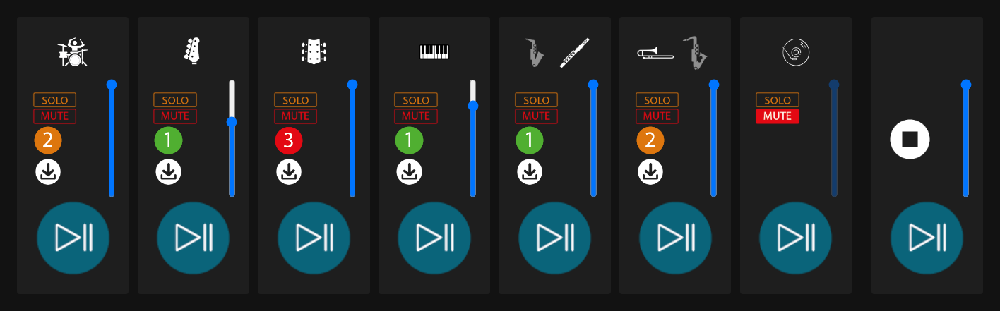

# Infini – a multitrack player for band practice

[](https://github.com/Utrope/Multi-track-audio-reader/actions/workflows/tests.yml)

*English · [Français](README.fr.md)* · Version 1.1 – see the [changelog](CHANGELOG.md) and the [roadmap](ROADMAP.md)

**An in-browser mixer to work on a song one instrument at a time.**
Each musician isolates their part, picks a difficulty level, turns down or mutes the other
tracks, and downloads the score that matches what they hear.

**[▶ Try the demo](https://utrope.github.io/Multi-track-audio-reader/)** · nothing to install, runs in the browser (interface in French)



## Features

- **7 tracks played together**, perfectly in sync: drums, bass, guitar, keyboard, two
  wind sections and the full backing track.
- **3 difficulty levels per instrument**, switchable mid-playback with no gap or drift.
- **Timeline**: see where you are in the song and jump anywhere.
- **A-B loop** to repeat a passage as many times as needed, on all tracks at once.
- **Instrument choice** for the wind sections (alto sax or flute, trombone or tenor sax).
- **Solo, Mute and volume** per track, plus a master volume.
- **PDF score** for the current instrument and level, in one click.
- **Keyboard accessible**, with labels for screen readers; adapts to small screens.

## Technical highlights

- **Web Audio API, no dependencies, no build step**: plain HTML, CSS and JavaScript
  (ES modules) served as-is by GitHub Pages.
- **Sample-accurate synchronized playback**: every source is scheduled on the same instant
  of the audio clock. A level change stops the old source and starts the new one at the
  exact same instant, at the same position.
- **Seamless A-B looping**: the loop is applied by the audio sources themselves
  (`loop` / `loopStart` / `loopEnd`), so it wraps sample-accurately and identically on
  every track. The current position is derived from a single playback anchor, which stays
  exact across pauses, seeks and level changes.
- **Consistent under concurrent changes**: each track keeps the latest requested variant
  and a request token, so late responses are ignored and rapid clicks always end in the
  right state.
- **LRU cache of decoded tracks**, which also shares in-flight loads: going back to a
  level you already heard is instant, with bounded memory.
- **A single mixing rule** (`applyGain`) combining volume, mute and solo, applied through
  one gain node per track and a master gain node.
- **Configuration-driven UI** (`config.js`): adding an instrument is a one-line change.
  Events go through a single delegated listener reading `data-action`.
- **Accessibility**: real `<button>` elements with labels, `aria-pressed` on toggles,
  visible keyboard focus, named sliders.
- **Resilience**: an error screen with a "Retry" button that only reloads the tracks that
  failed.

## Run locally

Tracks are loaded with `fetch`, so the page must be served over HTTP (opening
`index.html` straight from disk does not work). From the repository root:

```bash
python -m http.server 8000
```

then open <http://localhost:8000>.

## Tests

End-to-end tests with [Playwright](https://playwright.dev) (`tests/app.spec.js`): the page
loads the 7 tracks, Play starts and the position moves, a level change keeps playing,
Solo / Mute silence the right tracks, the A-B loop keeps the position between A and B, and
the score button downloads the right PDF. They run on every push and pull request with
GitHub Actions. To run them locally (Node.js and Python required):

```bash
npm install
npx playwright install chromium
npm test
```

To use the Chrome already installed on your machine instead of downloading Chromium, skip
the second command and run `PW_CHROME=1 npm test`.

## Usage

For each track:

- **Solo**: only play the soloed tracks (several allowed).
- **Mute**: silence the track. Moving its slider unmutes it.
- **Level** (1, 2, 3): go to the next level; the sound changes without interrupting playback.
- **Download**: PDF score for the current instrument and level.
- **Track play**: starts playback with this track soloed.
- Tracks 5 and 6: pick the instrument by clicking its icon.

Master column: play / pause, stop (also resets solos and mutes) and master volume.

Timeline, above the tracks: drag or click the bar to move in the song. **A** sets the
loop start at the current position, **B** sets its end and starts looping; **Boucle**
turns the loop on or off and **✕** clears it.

Everything works from the keyboard (Tab, Enter / Space, arrow keys for sliders).

## Project structure

| File | Role |
| --- | --- |
| `index.html` | Page and loading screen. |
| `config.js` | **List of tracks and instruments**, file paths, display names. |
| `audioLogic.js` | Audio engine (Web Audio API): loading and cache, synchronized playback, solo / mute / volume, levels, instruments, scores. |
| `main.js` | Builds the interface from `config.js` and handles clicks. |
| `styles.css` | Styling. |

### File naming convention

For an instrument `<instrument>` (the name used in `config.js`, e.g. `altoSax`) and a
level `N`:

```
tracks/lvlN/<instrument>_lvlN.mp3     audio track
scores/<instrument>/lvlN.pdf          score
images/Instruments/<instrument>.png   icon
```

The "prod" track uses a fixed file: `tracks/Infini_prod.mp3`.

All audio tracks must have the same length and start at the same instant: they are played
together, and a level change resumes at the same position.

## Adding or changing an instrument

1. Add the files following the convention above (one MP3 and one PDF per level, one PNG
   icon).
2. In `config.js`:
   - add the instrument name to the `instruments` array of an existing track (it then
     shows up in that track's switcher), or add a new entry to `TRACKS` for a new column;
   - add its display name to `INSTRUMENT_LABELS`.

Nothing else to change: the interface is generated from the configuration.

## Caveats

- **Memory**: each track is fully decoded (about 90 MB of memory for 4 minutes of
  stereo). With 7 tracks plus the cache of recently played levels, the page can use
  600 to 800 MB, which may be too much for a phone or a small tablet.
- **Repository size**: audio files are committed directly to Git. Avoid adding WAV files:
  the history already contains old, deleted WAV files weighing almost 1 GB, which makes
  every clone heavier.
